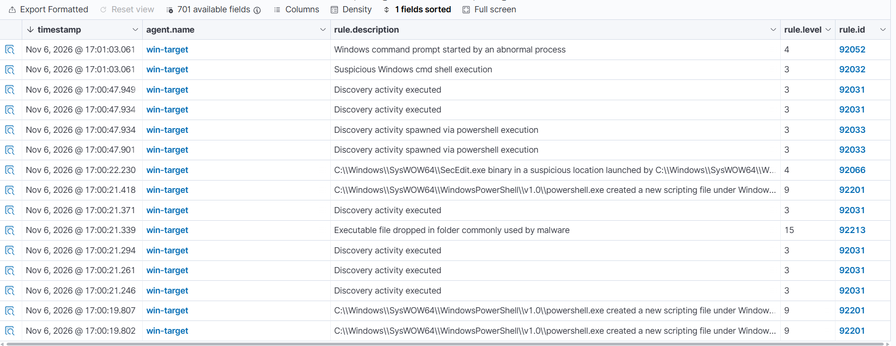

# Incident Report #01 — Алерт уровня 15 о создании исполняемого файла (триаж на FP)

| Поле            | Значение                                      |
|-----------------|-----------------------------------------------|
| **Дата**        | 2026-11-06 (время дашборда, часовой пояс уточнить) |
| **Аналитик**    | Madiyar                                        |
| **Источник алерта** | Wazuh SIEM (Threat Hunting → Events)       |
| **Хост**        | win-target (Windows Server 2022)              |
| **Rule ID**     | 92213                                          |
| **Severity**    | 15 (критический)                               |
| **Вердикт**     | Ложное срабатывание (False Positive) — **предварительно**, см. §4 |
| **Эскалация**   | Закрыл бы как FP после подтверждения источника |

---

## 1. Сводка (Summary)

На хосте `win-target` сработал алерт Wazuh уровня 15 (Rule ID 92213,
«Executable file dropped in folder commonly used by malware»). Алерт
появился сразу после перезагрузки сервера, в одной временной группе с
активностью PowerShell и запуском `SecEdit.exe`. По совокупности признаков
активность соответствует штатной работе агента мониторинга (оценка
конфигурации по CIS), а не действиям злоумышленника. Предварительный
вердикт — ложное срабатывание; для окончательного вывода нужно подтвердить
родительский процесс и путь созданного файла в полях события.

## 2. Хронология (Timeline)

> Время — как показано в дашборде Wazuh (поле `timestamp`). Часовой пояс
> дашборда уточнить: на самом сервере время отличалось, значит нормализация
> по TZ требует проверки. В отчёте все времена приводить к UTC.

| Время        | Rule ID | Уровень | Событие |
|--------------|---------|---------|---------|
| 17:00:19.807 | 92201   | 9  | powershell.exe создал новый скриптовый файл в каталоге Windows |
| 17:00:21.246–21.294 | 92031 | 3 | Discovery activity executed |
| 17:00:21.339 | 92213   | 15 | **Executable file dropped in folder commonly used by malware** |
| 17:00:21.371 | 92031   | 3  | Discovery activity executed |
| 17:00:21.418 | 92201   | 9  | powershell.exe создал новый скриптовый файл |
| 17:00:22.230 | 92066   | 4  | SecEdit.exe из SysWOW64 запущен из подозрительного расположения |
| 17:00:47.901–47.949 | 92031 / 92033 | 3 | Discovery activity (в т.ч. spawned via powershell) |
| 17:01:03.061 | 92032 / 92052 | 3–4 | Suspicious cmd shell execution / cmd запущен ненормальным процессом |

## 3. Индикаторы (Observables / IOC)

| Тип | Значение |
|-----|----------|
| Хост | win-target |
| Пользователь | _(подтвердить: `data.win.eventdata.user`)_ |
| Процесс | _(подтвердить: `data.win.eventdata.image`)_ |
| Родительский процесс | _(подтвердить: `data.win.eventdata.parentImage`)_ |
| Командная строка | _(подтвердить: `data.win.eventdata.commandLine`)_ |
| Созданный файл | _(подтвердить: `data.win.eventdata.targetFilename`)_ |
| Хеш | _(подтвердить: `data.win.eventdata.hashes`, если есть)_ |

> Эти поля я беру из раскрытого события 92213 в дашборде. До их подтверждения
> вердикт остаётся предварительным.

## 4. Анализ (Analysis)

**Что наблюдаем.** Группа алертов 17:00:19–22 возникла сразу после
перезагрузки `win-target`. В ней: PowerShell создаёт скриптовые файлы
(92201), запускается `SecEdit.exe` из `SysWOW64` (92066), и фиксируется
создание исполняемого файла в «подозрительной» папке (92213).

**Рабочая гипотеза — ложное срабатывание.** `SecEdit.exe` — штатная утилита
Windows для работы с политиками безопасности. Агент Wazuh при старте
выполняет оценку конфигурации (SCA, проверки по CIS), и в ходе неё легитимно
запускает PowerShell и `SecEdit.exe` и создаёт временные файлы. Это типичный
источник шумных алертов высокого уровня сразу после запуска агента. Совпадение
по времени с перезагрузкой и присутствие `SecEdit.exe` поддерживают версию FP.

**Что отличало бы реальную угрозу.** Насторожило бы, если бы:
- родительским процессом был не агент Wazuh / не доверенный системный
  процесс, а, например, офисное приложение, браузер или неизвестный бинарь;
- созданный файл лежал в пользовательских/временных каталогах загрузок и имел
  случайное имя, а его хеш был известен как вредоносный (проверка по VirusTotal);
- активность не была привязана к штатному событию (перезагрузка, запуск агента).

**Что нужно подтвердить для окончательного вердикта (поля §3):**
`parentImage` указывает на процесс агента Wazuh, а `targetFilename` — на
служебный/временный путь, связанный с SCA. Если так — FP подтверждён.

## 5. MITRE ATT&CK

> Техники показаны по привязке правил Wazuh. При FP это означает, что
> легитимная активность внешне похожа на эти техники.

| Техника | ID | Как проявилась |
|---------|----|----|
| Account Discovery / System Discovery | T1087 / T1082 | «Discovery activity» — команды перечисления (в т.ч. мои собственные `whoami`, `net user`, `net localgroup`) |
| Command and Scripting Interpreter: PowerShell | T1059.001 | PowerShell создавал скриптовые файлы |

## 6. Рекомендации (Recommendations)

- Для снижения шума — добавить исключение/настройку правила так, чтобы
  активность SCA агента Wazuh (запуск `SecEdit.exe` и временные файлы агента)
  не поднимала алерт уровня 15. Делать это только после точного подтверждения
  источника, чтобы не заглушить настоящую угрозу.
- Задокументировать «нормальное» поведение после перезагрузки как базовую
  линию (baseline), чтобы отличать его от аномалий.
- Привести время во всех источниках к единому часовому поясу (UTC).

## 7. Вывод по эскалации

Предварительно — закрыл бы как **ложное срабатывание**, без эскалации на L2,
**при условии** что поля `parentImage` / `targetFilename` подтверждают
источник (агент Wazuh / SCA). Если же родитель окажется недоверенным или файл
подозрительным — эскалация на L2 с приложением IOC и хронологии.

---
*Скриншоты: `../screenshots/`. Выгрузки логов: `../logs/`.*
*Отчёт основан на моём собственном анализе логов учебного стенда.*
