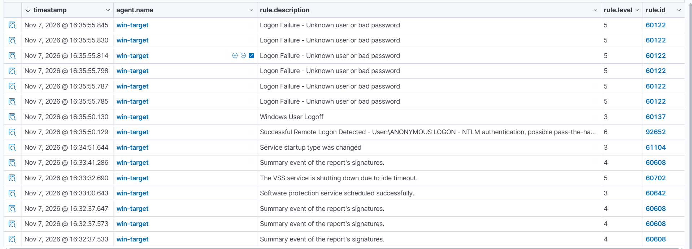
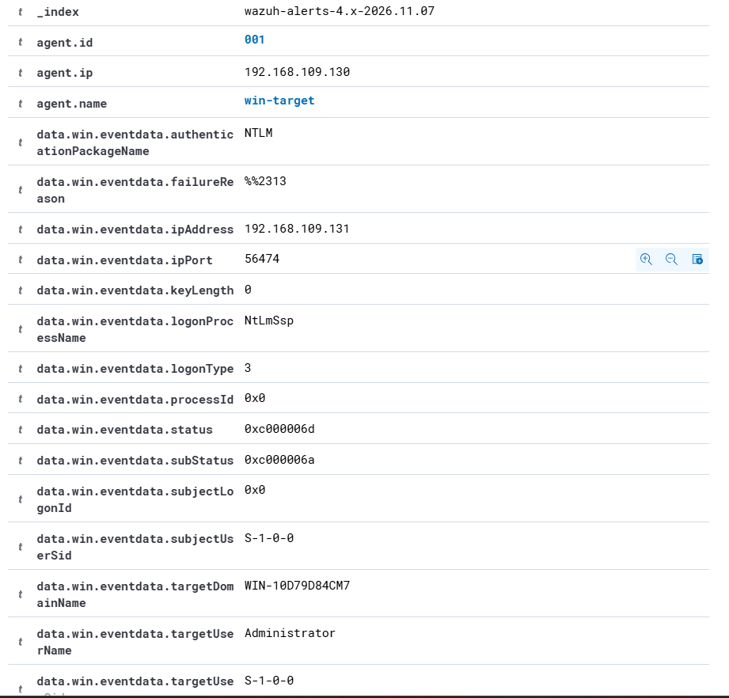
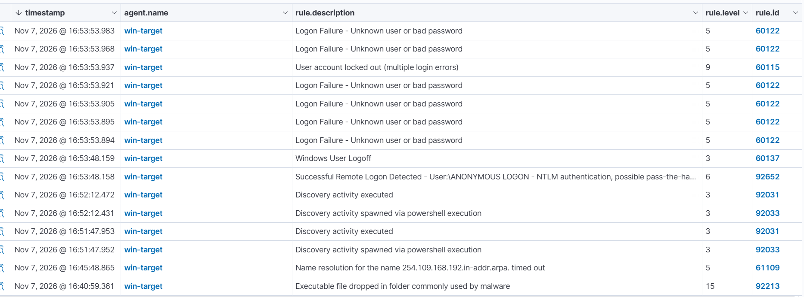

# Incident Report #02 — Подбор пароля к учётной записи Administrator (SMB / NTLM)

| Поле            | Значение                                      |
|-----------------|-----------------------------------------------|
| **Дата**        | 2026-11-07 (время дашборда; привести к UTC)   |
| **Аналитик**    | Madiyar                                        |
| **Источник алерта** | Wazuh SIEM (Threat Hunting → Events)       |
| **Хост (цель)** | win-target (Windows Server 2022), 192.168.109.130 |
| **Источник атаки** | 192.168.109.131 (Kali)                     |
| **Rule ID**     | 60122 (Logon Failure), 92652 (ANONYMOUS LOGON) |
| **Severity**    | 5 (неудачный вход), 6 (анонимный логон)       |
| **Вердикт**     | True Positive — попытка подбора пароля (brute force) |
| **Эскалация**   | Эскалация на L2 (атака на привилегированную учётку) |

---

## 1. Сводка (Summary)

На хосте `win-target` зафиксирована серия неудачных сетевых входов (Event ID
4625, Wazuh Rule 60122) к учётной записи `Administrator`. Все попытки пришли
с одного адреса — `192.168.109.131` — в пределах одной секунды, что
характерно для автоматического подбора пароля (brute force). Поле subStatus
`0xC000006A` указывает, что учётная запись существует, а неверен пароль:
атакующий целенаправленно перебирал пароль к известной привилегированной
учётке. Подбор в рамках теста **не увенчался успехом** (событие 4624 с этого
IP как результат перебора не зафиксировано — см. §4).

## 2. Хронология (Timeline)

> Время — как в дашборде Wazuh. Привести к UTC.

| Время        | Rule ID | Уровень | Событие |
|--------------|---------|---------|---------|
| 16:35:50.129 | 92652   | 6  | Successful Remote Logon — ANONYMOUS LOGON (NTLM) — предшествующая разведка инструмента |
| 16:35:50.130 | 60137   | 3  | Windows User Logoff |
| 16:35:55.785–55.845 | 60122 | 5 | Серия Logon Failure — Unknown user or bad password (6 попыток за ~1 сек) |

> Замечание: анонимный вход (16:35:50) произошёл **раньше** серии неудачных
> (16:35:55). Это не «пароль подобран после перебора», а характерное
> поведение инструмента: сначала анонимное подключение для сбора информации
> о хосте, затем перебор пароля.



## 3. Индикаторы (Observables / IOC)

| Поле | Значение |
|------|----------|
| Хост-цель | win-target (192.168.109.130) |
| IP источника (`ipAddress`) | 192.168.109.131 |
| Порт источника (`ipPort`) | 56474 |
| Учётная запись (`targetUserName`) | Administrator |
| Домен цели (`targetDomainName`) | WIN-10D79D84CM7 |
| Тип входа (`logonType`) | 3 (сетевой) |
| Протокол (`authenticationPackageName`) | NTLM |
| Процесс входа (`logonProcessName`) | NtLmSsp |
| Причина отказа (`failureReason`) | %%2313 (bad password) |
| status / subStatus | 0xC000006D / 0xC000006A |



## 4. Анализ (Analysis)

**Что наблюдаем.** Шесть событий Logon Failure (Rule 60122 / Event ID 4625)
за ~1 секунду, все с одного IP `192.168.109.131`, все по учётке
`Administrator`, тип входа 3 (сеть), протокол NTLM.

**Ключевой признак — subStatus `0xC000006A`** («верный пользователь, неверный
пароль»). Значит, имя учётной записи угадано/известно, а подбирается именно
пароль. Это отличает нашу ситуацию от перебора самих имён пользователей
(там был бы `0xC0000064`).

**Высокая плотность попыток** (6 за секунду) не соответствует человеку,
набирающему пароль вручную, и указывает на автоматический инструмент.

**Удался ли подбор.** В рамках теста события 4624 (успешный вход) с
`192.168.109.131` как результат перебора пароля `Administrator` не
зафиксировано → подбор **безуспешен**. Событие 92652 (ANONYMOUS LOGON) —
это не удавшийся подбор, а анонимная разведка хоста перед перебором;
её источник подтвердить по полю IP в самом событии 92652.

**Почему True Positive.** Это не штатная активность: внешний (для сервера)
узел массово и автоматически перебирает пароль к привилегированной учётной
записи. Даже при неуспехе это реальная вредоносная активность, требующая
реакции.

## 5. MITRE ATT&CK

| Техника | ID | Как проявилась |
|---------|----|----|
| Brute Force: Password Guessing | T1110.001 | Серия неудачных входов к одной учётке с одного IP |
| Valid Accounts | T1078 | Цель — существующая привилегированная учётка Administrator |

## 6. Рекомендации (Recommendations)

- Включить **политику блокировки учётной записи** (Account Lockout) — блокировка
  после N неудачных попыток, чтобы остановить перебор.
- Ограничить сетевой доступ к SMB/службам аутентификации с недоверенных узлов.
- Отключить **NTLM** там, где возможно, и запретить ANONYMOUS LOGON.
- Переименовать/отключить встроенную учётку `Administrator`, использовать
  индивидуальные учётные записи.
- Настроить алерт SIEM на «N и более 4625 с одного IP за короткое окно».

## 7. Вывод по эскалации

**Эскалация на L2.** Несмотря на неуспех подбора, это целенаправленная атака
на привилегированную учётную запись с живого узла. L2/IR проверяют, не было
ли с этого IP других действий, и принимают меры по блокировке источника.
Приложить: IOC (§3), хронологию (§2), скриншоты событий.

## 8. Проверка защиты (Remediation & Validation)

Для проверки рекомендации из §6 включена политика блокировки учётной записи:

```
net accounts /lockoutthreshold:5 /lockoutduration:15 /lockoutwindow:15
```

(блокировка после 5 неудачных попыток, на 15 минут).

**Повторный перебор с того же источника** дал другой результат — учётная
запись была заблокирована:

| Время        | Rule ID | Уровень | Событие |
|--------------|---------|---------|---------|
| 16:53:48.158 | 92652   | 6  | ANONYMOUS LOGON (разведка перед перебором) |
| 16:53:53.894–53.983 | 60122 | 5 | Серия Logon Failure (неудачные попытки) |
| 16:53:53.937 | **60115** | **9** | **User account locked out (multiple login errors)** — Event ID 4740 |



**Сравнение «до / после»:**

| | Без защиты | С блокировкой |
|---|-----------|---------------|
| Ключевые события | только 60122 | 60122 + **60115 (блокировка)** |
| Итог | перебор не ограничен | учётка блокируется после 5 попыток |

**Вывод:** рекомендованная мера (Account Lockout Policy) подтверждена на
практике — автоматический перебор пароля останавливается блокировкой учётной
записи, что видно в SIEM по событию 4740 / Rule 60115.

> Замечание: блокировка встроенной учётки `Administrator` может создать риск
> отказа в обслуживании (злоумышленник намеренно блокирует админа). Поэтому в
> продакшене вместе с блокировкой применяют индивидуальные учётки и ограничение
> сетевого доступа к службам аутентификации.

---
*Скриншоты: `../screenshots/`. Выгрузки логов: `../logs/`.*
*Отчёт основан на моём собственном анализе логов учебного стенда.*
